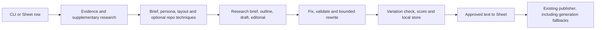
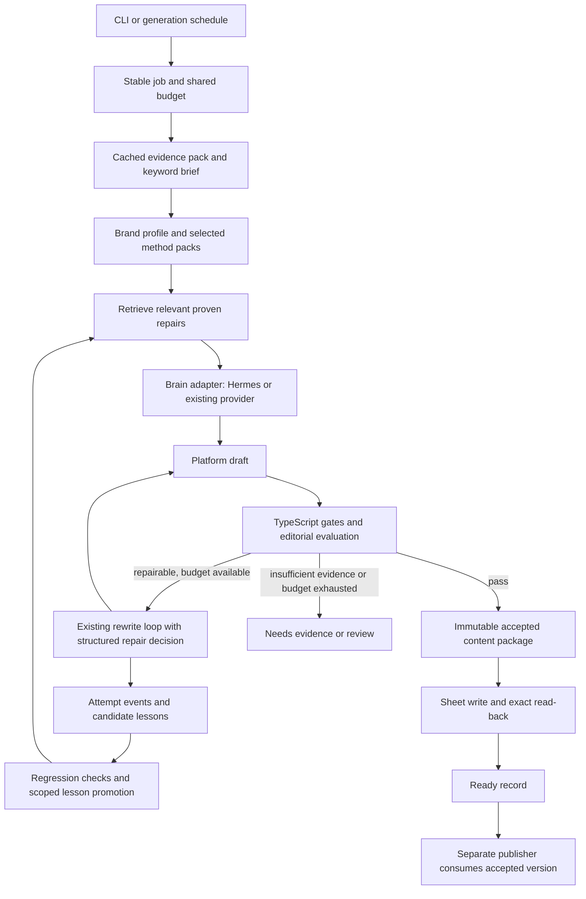

# Social text Content Engine: architecture and implementation plan
Date: 14 October 2026. Status: proposed; documentation only. Scope: Ken Research Facebook and LinkedIn text posts. The user's latest requirements take precedence over the existing implementation. Blog and image generation follow after this text pipeline is accepted.

## 1. Intended outcome

Keep the TypeScript engine as the owner of evidence, rules, validation, jobs and Sheet writes. Add a Hermes-assisted writing and repair layer, with selected methods adapted from reviewed GitHub repositories. Codex can help build, operate and evaluate it; unattended operation requires a configured model provider and a running scheduled worker.

The engine must produce useful, brand-specific posts with natural keywords, supported insights, appropriate platform structure and a clear report link. A failed draft should trigger a bounded repair, produce an observable record of the failure and action, and contribute a tested lesson that a later similar job can retrieve.

“SEO optimized” here means an explicit keyword/entity brief, topic relevance, understandable answers and useful links. A local quality score is an editorial measure; it does not demonstrate search rankings or platform reach. Treat advice about hashtags, posting frequency and algorithms from repositories as hypotheses to test.

Start with two or three real source items as a pilot. Produce FB and LI versions from each evidence pack and compare them with the current engine. The pilot therefore covers four to six platform outputs, with extra candidate drafts only when the budget permits. It is not a request to generate invented sample market facts.

## 2. What exists today

These findings come from the current local files, read on 14 October. The earlier audit in Branding Distribution is partly superseded, particularly its Sheet write-back finding.

Workspace detail: the actual engine is under `Desktop/Read Me/reponse/x-posting-agent/content-engine`, outside this chat's initial Branding Distribution folder. `content-engine` has its own Git root inside the parent posting-agent checkout. Engine changes and parent publisher changes therefore need separately reviewed Git changes and a shared contract test; a parent-only diff does not show all engine edits.

| Area | Current behavior and evidence | Consequence for this plan |
|---|---|---|
| Entry points | [cli.ts](../../src/cli.ts): `generate`, `next`, `next:fb`, `next:li`, evidence, validation, repo intake and lab commands | Extend existing commands and contracts rather than create another application. |
| Evidence | [source-policy.config.ts](../../src/config/source-policy.config.ts), [supplementary-evidence.ts](../../src/pipeline/supplementary-evidence.ts): Ken/government numeric evidence; optional neutral external background | Preserve source tiers and attribution through every repair. |
| Strategy | [campaign.config.ts](../../src/config/campaign.config.ts) has empty keyword clusters; [brief-builder.ts](../../src/strategy/brief-builder.ts) combines campaign terms with a lowercased title | Add explicit primary/secondary keywords and intent; title presence alone is insufficient. |
| Writing | [run-plan.ts](../../src/pipeline/run-plan.ts) and [generate-content.ts](../../src/pipeline/generate-content.ts): FB/LI full mode has research brief, outline, draft and editorial stages | Existing normal flow can make four writing calls before repairs; measure and consolidate for the lean profile. |
| Repairs | [rewrite-loop.ts](../../src/rewrite/rewrite-loop.ts) already records attempts, runs fixers and bounded rewrites | Add Hermes decision/lesson hooks to this loop; do not add an independent retry loop around it. |
| Acceptance | [validate-draft.ts](../../src/validation/validate-draft.ts): review warnings can pass. In `run-plan.ts`, scoring does not itself turn an approved result into a rejection | Separate factual/brand gates from an enforceable editorial rubric. |
| Repo methods | [github.ts](../../src/repos/github.ts) reads at most six matching files; [techniques.ts](../../src/repos/techniques.ts) loads at most eight techniques in filename order | Intake can miss relevant files and early files can consume the entire method budget. Add targeted paths and routing. |
| Actual method use | `config/techniques/` currently contains only `GEO-optim__GEO.json`; techniques are disabled by default in the plan runner | Registry presence or a lab clone does not mean methods are active during generation. |
| Repo lab | [lab.ts](../../src/lab/lab.ts) clones, runs a supplied command with a scrubbed environment, and checks supplied output | Keep it for experiments. Its `wouldPass` means no hard failures, not independently demonstrated writing quality. |
| Sheets | [social-sheet.ts](../../src/sheets/social-sheet.ts) checks row URL, posting status, published URL and existing text; writes the Post cell and reads it back | Write-back exists. CLI currently warns on a read-back mismatch; make mismatch a failed handoff. |
| Queue | `next` skips completed drafts and remembers no-fact rows in `output/skipped-rows.json`, keyed by platform/row index | Replace row-number identity with stable jobs and versioned retry eligibility. |
| Publishing | `Read Me/reponse/x-posting-agent/src/coordinator/masterCoordinator.ts` consumes Sheet text but still generates/regenerates missing or invalid FB/LI text | For migrated text paths, return a regeneration request to the engine. Publishing must not silently change accepted text. |
| Memory | No Hermes integration was found in the engine source/config/package examined | Existing attempt logs need cross-run lesson retrieval and an explicit Hermes bridge. |

Current flow:

## 3. Proposed ownership and flow

TypeScript retains final authority over facts, budgets and acceptance. Hermes supplies writing, repair recommendations and reusable procedures. It cannot weaken a source rule or declare its own draft valid. Use the existing `LlmProvider` interface in [contracts.ts](../../src/contracts.ts) for writing, plus a separate typed repair-decision operation; avoid making a second orchestration framework the owner of the same stages.

Initial integration should be one isolated Hermes content profile and one active worker. Use a version-pinned supported CLI/protocol adapter, after a headless smoke test proves response framing, exit status, timeout, cancellation and authentication behavior. Do not assume an interactive CLI emits the engine's JSON schema. For tool access, expose narrow engine operations through a structured CLI wrapper first; add MCP only if the selected Hermes integration actually needs it.

TypeScript owns attempt transitions. A Hermes invocation returns one candidate or one repair decision; internal model/tool activity must be observable and charged to the shared budget. Disable recursive generation, delegation and independent retry policies in this profile. A prompt alone is insufficient enforcement: if the chosen adapter cannot expose usage or enforce the permitted operation boundary, keep it in supervised mode until that boundary is implemented.

Proposed operations: `get_job_context`, `read_evidence_pack`, `lookup_repair_lessons`, `validate_candidate`, `record_repair_decision`, `submit_candidate`. Sheet commit stays in the engine after acceptance. Each operation validates input with Zod and references IDs instead of handing the model the complete environment or account files.

## 4. Contracts and acceptance

Introduce versioned schemas without replacing the existing Fact/SourceNote/LlmProvider structures:

| Contract | Minimum fields |
|---|---|
| Job | Stable source ID, canonical report URL, platform, campaign, rule version, input revision, status, lease, idempotency key |
| EvidencePack | Facts and notes with source URL, tier, supporting excerpt, geography, period, publication/retrieval date, verification status and content hash |
| KeywordBrief | Primary phrase, permitted variants, optional secondary phrases, entities, audience question, intent, placement policy and origin of each suggestion |
| MethodPack | Repo, commit, inspected paths, license/notice references, method version, stage, platform, evidence prerequisites, conflicts, token estimate and benchmark result |
| ValidationResult | Stable rule codes, severity, supporting text spans, repairability, local checks and semantic-review findings separately |
| ContentPackage | Final text and hash, source/job IDs, evidence/brief/rule/method versions, validation, chosen candidate rationale and attempt IDs |
| Budget | Model calls/tokens, search queries/pages, deadline, quality attempts, transport retries and provider fallback policy |

Rules apply in this order: latest user requirements; approved source and brand policy; platform acceptance profile; scoped tested repair procedures; selected repository suggestions. Raw source pages and repository text are data to inspect, not instructions with authority over this order.

### Evidence policy

Keep numeric facts and factual citations limited to verified Ken Research and approved government/regulatory sources. Government figures remain attributed to the actual institution. A related report's figure must match the market, geography, period and metric; sharing a keyword does not establish equivalence.

The current configuration explicitly records a later user decision allowing neutral, number-free background from eligible non-competitor sites when the report lacks a recent verified figure. Preserve this as a separately labeled policy mode, alongside `ken-gov` and report-only modes. Do not silently convert those notes into authoritative statistics, quotations or Ken claims. Finalize one policy profile for the pilot so all adapters enforce the same decision.

Do not invent data to make a post richer. A number-free draft is acceptable only under the selected qualitative profile with sufficient supported notes; otherwise return `needs_evidence`. Numeric checks cannot establish that all prose is true: source-linked assertions and limited semantic review remain necessary.

### Platform profiles

| Dimension | Facebook text | LinkedIn text |
|---|---|---|
| Reader | Accessible explanation for the defined audience | Professional audience and decision context |
| Opening | Clear market/topic question or useful observation | Specific evidence-led observation or supported business question |
| Development | Explain the finding and why the reader should care | Connect evidence to a qualified implication and decision |
| Structure | Short readable paragraphs or approved point format | Approved insight, bullet or question structure appropriate to evidence |
| Ending | Relevant report link and useful invitation | Report link and a substantive professional question where useful |

Retain existing approved layouts until the pilot justifies changes. In particular, a myth/reality layout must not invent a public belief or consensus to create a dramatic hook. Brand voice should come from approved examples, including successful past posts, with positive and negative examples and explicit boundaries on promotional claims.

Proposed hard gates: supported claims and valid source tiers; no conflicting/stale/misattributed figures; required primary keyword or approved variant in visible post text; correct report link and brand naming; configured platform limits; no placeholders, model artifacts or prohibited claims. Exact wording, placement, length and hashtag counts belong in editable versioned profiles, not assumed universal SEO rules. Hashtags alone do not satisfy the body keyword rule. Do not force unrelated secondary terms or fixed keyword density.

Proposed editorial rubric: topic/intent coverage, supported specificity, useful explanation, audience relevance, brand voice, readability and differentiation. A pilot starting threshold is 80/100, with no critical dimension below its configured minimum. This number is a proposed editorial setting, to calibrate against accepted/rejected examples. Local checks screen measurable features; Hermes can return cited review findings for ambiguous meaning. A score or sentence count alone cannot establish depth.

## 5. Failure, repair and learning

Extend the existing rewrite loop with structured events and one shared budget. Preserve the best valid candidate and compare the new draft against all non-negotiable rules after every edit.

| Failure | First response | Stop condition |
|---|---|---|
| Formatting, duplicate whitespace, approved deterministic fix | Existing local fixer; revalidate | No model call needed if resolved |
| Missing keyword with otherwise sufficient evidence | Targeted rewrite using the existing brief | Keyword would distort meaning, or repair budget exhausted |
| Thin/generic draft | Identify missing supported explanation; one bounded evidence refresh if needed; targeted rewrite | Evidence still insufficient |
| Unsupported number or attribution | Restore a supported claim or remove the unsupported claim; recheck related prose | Unresolved conflict or ambiguous source mapping |
| No usable evidence | Allowed supplementary lookup or qualitative profile | Return `needs_evidence`; never fabricate |
| Repeated repair failure | Change repair approach after the second identical failure | At most three quality attempts in total |
| Rate limit, timeout or provider outage | Bounded transport retry under the same deadline | Return provider/budget error; do not call this a writing lesson |
| Sheet write/read-back mismatch | Persist handoff failure and reconcile exact accepted text | Never mark ready or regenerate merely because commit failed |

Persist observable steps and short decision summaries, tool results and before/after findings. No hidden model reasoning is required.

An attempt event should include run/job/platform IDs, attempt/parent IDs, error fingerprint, rule and evidence versions, selected methods/lessons, repair action, before/after text hashes, validation results, adoption/rejection reason, resource usage and final outcome. Save every attempt, including rejected edits and outages.

A repair lesson should contain: failure signature, platform and rule scope, preconditions, procedural action, supporting successful trace IDs, counterexamples, status (`candidate`, `tested`, `active`, `retired`), validation versions and expiration/retest conditions. A successful single repair creates a candidate; a separate regression case and a similar held-out failure must pass before automatic promotion. A later contradiction retires or narrows the lesson. Raw failed repairs are negative examples, not instructions to repeat.

Retrieve a few lessons by platform, failure code, rule version and evidence availability. Start with a small local index over existing JSON storage; do not add embeddings or a separate vector database. Keep economic statistics in fresh evidence packs, never as evergreen repair memory.

Hermes integration has explicit boundaries:

- Send each failure report and the subsequent verified result to Hermes; it cannot infer arbitrary TypeScript log events automatically.
- Keep the full canonical traces in the engine. Store compact procedural references and approved repair skills in the dedicated Hermes profile.
- Hermes memory is loaded as a session-start snapshot. Pass current repair feedback explicitly in the same job rather than expecting a memory write to alter the current system prefix. Run only one writer per profile. See the official [memory documentation](https://hermes-agent.nousresearch.com/docs/user-guide/features/memory).
- Load procedures only when relevant, using the [skills system](https://hermes-agent.nousresearch.com/docs/user-guide/features/skills). New procedures remain candidates until the engine's regression gate passes.

The acceptance test for “learning” is concrete: a later fresh job encounters the same failure class, retrieves the right scoped lesson and resolves it while preserving the evidence and brand rules. Merely saving a chat or claiming to remember does not pass.

## 6. GitHub methods and minimal resource use

See the accompanying [repository research](repository-research-2026-10-14.md) for verified stars, licenses, source files and commit snapshots.

Use three roles: writing methods (Marketing Skills and selected Anthropic marketing files), optional polish (Humanizer), and evaluation tooling (existing Vitest first; Promptfoo later if useful). Hermes is the procedural-memory runtime. Repositories are not sources of market facts.

Upgrade intake to accept explicit files and purpose, capture read failures/coverage, pin commits and hashes, retain licenses and notices, then normalize selected methods into small reviewed packs. Route packs by platform, writing stage, failure class and evidence prerequisites. Select a small bounded set by relevance, not alphabetic filename order. Reject conflicting advice and benchmark a pack before enabling it. Adding a repo should create a candidate pack, not automatically install or execute its application.

Proposed initial resource settings, subject to pilot measurement:

- One active generation job and one Hermes profile; reuse one evidence pack across FB/LI while writing distinct posts.
- One combined writing call for the normal lean path, with a second review/repair call only when warranted. This is a target to test against the current four-stage FB/LI flow, not a promised quality equivalence.
- At most two repair calls and three total candidate-writing attempts. All optional candidates, critiques, provider fallbacks and lesson distillation share an overall call/token/deadline cap. A separate model judgment consumes the same cap.
- Initial proposed hard cap per platform job: five outbound model requests including fallback attempts, 8,000 generated tokens where metering is supported, and an eight-minute deadline. Record unmetered usage as unknown rather than zero; in that case enforce requests and time. These are pilot settings, to revise from measured quality and latency.
- At most one supplementary research round, initially two search queries and four fetched pages, with clear budget exhaustion outcomes. Cache by query/source and evidence freshness; policies determine refresh intervals.
- Use current local validators and claim checks before asking a model to revise. Distill lessons after a batch or deterministically where possible.
- No initial Redis, orchestration platform, training run, external memory service or large local model requirement. Move storage to SQLite only when locking/query volume makes it useful; retain the Store interface.

The existing provider chain supports local and API routes; populated environment variable names do not prove quotas, credit or working credentials. Current PowerShell has Codex and Python available, while `hermes` was not found on PATH. The official Hermes repo now supports [native Windows](https://github.com/NousResearch/hermes-agent#windows-native-powershell); WSL2 is optional. Installation must follow the pinned release's requirements rather than assuming the existing Python version is sufficient.

“Use you as the brain” has two operating modes. In an active Codex session I can inspect inputs, run generation/validation and repair drafts through the engine. For unattended runs, a separately configured provider must be callable by the worker; this conversation is not an always-on model endpoint. Hermes documents a [Codex/ChatGPT OAuth provider](https://hermes-agent.nousresearch.com/docs/user-guide/configuration), which may allow subscription-backed use without an API key. Verify account eligibility, authentication, headless behavior and model availability in a smoke test; subscription limits still apply. Existing `.env` providers remain explicit fallbacks under a declared cost policy. Free repository licenses do not make model inference or research services unlimited or free.

## 7. Jobs, Sheets and publishing boundary

Proposed generation states:

`queued -> researching -> drafting -> validating -> repairing -> accepted -> sheet_committing -> ready`

Terminal/non-ready states: `needs_evidence`, `needs_review`, `provider_failed`, `budget_exhausted`, `commit_failed`. Store reason codes and next retry eligibility. A source refresh, corrected brief or new rule version can reopen an evidence-blocked job; moving a Sheet row cannot change its identity.

Derive stable jobs from an immutable Sheet/source ID, canonical source URL, platform and input revision. Track rule/method versions to distinguish deliberate regeneration from a duplicate request. Use a single worker with an exclusive lease and durable checkpoints. Resume from the last completed stage; never rerun research or writing merely to repeat a Sheet write.

For the event journal, use one writer, stable event IDs, replayable checkpoints and recovery from a partial final record. Validate recovery on the actual Windows/OneDrive filesystem; do not treat file rename or cloud synchronization as a complete transaction system. Escalate to SQLite with a tested local storage location if these guarantees cannot be met simply.

Keep the current row identity/status/URL preflight and Post-cell write. Require exact successful read-back before `ready`. Reconcile a crash after remote write by reading and comparing the accepted text hash. Google Sheets read-check-write is not an atomic compare-and-set: prevent overlapping local writers and define a dedicated draft tab or coordinated writer before scaling. A local lease alone cannot prevent another independent client editing the same cell.

During the pilot, keep accepted packages local or use a dedicated draft destination: the live publisher can consume a newly populated Post cell with blank status. A preview command must not silently publish through that handoff.

When migrating production FB/LI text, require the publisher to consume a `ready` package and exact version/hash; invalid or absent content creates a regeneration request. Preserve current platform posting status semantics until both readers/writers are migrated. A package manifest can hold generation readiness separately; do not invent a new Sheet status that current selectors interpret incorrectly. Posting records belong to the publisher, generation attempts and lessons to the engine.

Scheduling comes after this boundary works. Keep generation and posting schedules separate, with an agreed lead time and Asia/Kolkata timezone. An unattended worker needs the machine/service available, authentication, a durable queue and notifications for actionable failures. Do not rely on this chat continuously watching the terminal. No schedule or live posting configuration changes are included in this plan.

## 8. Implementation sequence and acceptance evidence

| Phase | Main files/modules to extend | Completion evidence |
|---|---|---|
| 1. Freeze requirements and baseline | Existing config/schemas, `brief-builder.ts`, `validate-draft.ts`, layouts | Versioned brand/keyword/platform profiles; baseline on 2–3 genuine source items; explicit evidence mode and rejected examples. |
| 2. Enforce quality | Validation checks, `run-plan.ts`, existing rewrite classifier | Missing primary keyword, thin content and source failures block the correct profile; no hard-rule regression; quality failures reach the existing repair loop. |
| 3. Curate repo methods | `repos/github.ts`, `repos/techniques.ts`, config packs | Pinned source provenance, actual file coverage, relevant selection, conflict checks; benchmark better than baseline before enabling. |
| 4. Add repair history and Hermes | `rewrite-loop.ts`, store/contracts; proposed `learning/`, `integrations/hermes/` | Full attempt events; provider smoke test; candidate/active lesson lifecycle; fresh similar job demonstrably retrieves a successful repair. |
| 5. Make jobs and commits reliable | `cli.ts`, `social-sheet.ts`; proposed `jobs/`, accepted-package manifest | Stable IDs, exclusive worker, resume without duplicate writing; read-back mismatch fails; dry run and dedicated pilot destination work. |
| 6. Separate production publisher | Parent coordinator, Sheet adapters and ready-package consumer | Publisher sends exact accepted FB/LI text; missing/invalid package requests generation; no generation fallback on migrated paths. |
| 7. Schedule and observe | Existing scheduler integration after pilot | Agreed run time/volume, restart recovery, bounded usage, actionable alerts and reconciliation report. |
| Later | Blog/image adapters | Reuse contracts and evidence, then define blog-specific structure, SEO and acceptance separately. |

Phases 2–5 should first run in shadow/pilot mode. No new generation architecture should replace live posting before the package handoff is tested. Keep the old method version selectable for rollback and retain accepted artifacts for comparison.

Pilot cases: (1) recent verified numeric evidence; (2) sparse numeric evidence with the chosen qualitative/supplementary policy; (3) conflicting periods, geography or source attribution. Record current and proposed outputs, evidence mappings, quality findings, repair counts, repeated failures, calls/tokens, research fetches, elapsed time and human preference. If only two source items are available, cover the conflict case with a controlled validation fixture.

Required tests at implementation time: meaningful rejection/repair cases, unsupported claim introduced by a rewrite, a lesson applied outside its scope, repeated failure switching approach, exhausted shared budget, cancellation, provider outage, moved/edited Sheet row, existing published row, write/read-back mismatch, crash after successful remote write and duplicate job restart. Use recorded evidence and existing Vitest for routine checks; do not require live API calls for every test. Promptfoo can compare method variants on those same fixtures later.

Success means acceptable FB/LI content with traceable support, natural required keywords, consistent brand voice, proven repair reuse, bounded resource usage and a reliable ready-package handoff. Rankings, reach and click-through require later measured outcomes; they are not established by passing this pilot.

## 9. Architecture decisions

| Decision | Choice and tradeoff |
|---|---|
| Core ownership | Keep TypeScript engine authoritative; Hermes is a replaceable brain/procedure adapter. This adds a bridge but preserves current evidence/Sheet code and deterministic acceptance. |
| Repo reuse | Prefer reviewed methods over running several content apps. This needs curation but avoids duplicate databases, providers and orchestration. |
| Learning | Engine traces plus tested procedural lessons; compact Hermes references. More explicit than chat history alone, but auditable and portable. |
| Storage | Existing JSON Store plus single-writer event journal/index initially. Add SQLite when demonstrated concurrency/search requirements justify it. |
| Evaluation | Local gates plus selective model review, calibrated with human examples. Cheaper than multi-agent critics; semantic judgment remains imperfect. |
| Rollout | FB/LI pilot, then publisher contract, then scheduling, then blogs/images. This defers breadth to prove quality and recovery first. |

## 10. Inputs to finalize during Phase 1

The plan can proceed with the existing configuration. Before production activation, settle the exact required keywords/variants, accepted FB/LI examples, length/layout preferences, quantitative versus qualitative policy, research and model budget, subscription/API route, and generation timing/volume. “Hermes” has been interpreted as `NousResearch/hermes-agent`; a different Hermes project would require revisiting the integration adapter only.

This planning pass changed documentation only. No Hermes installation, package adoption, live content generation, credential validation, Sheet update, publication or schedule change was performed.

