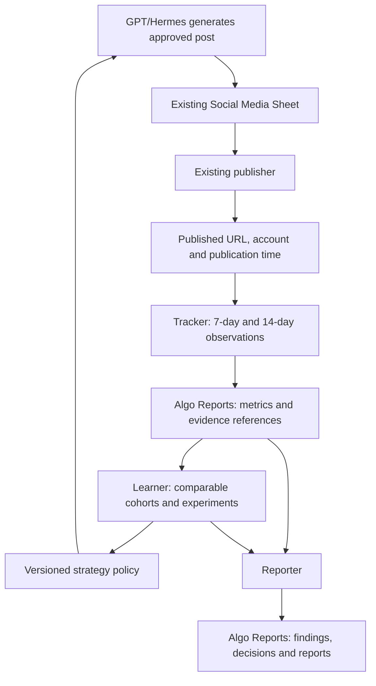

# Performance Engine: implementation plan

Status: core implementation, universal public-URL collection and tests completed on 16 October 2026. A mature 7/14-day performance pilot remains outstanding. Official per-account analytics are an optional enhancement for metrics that public pages hide. README.md, OPERATIONS.md and TEST_REPORT.md describe actual capabilities and verification; the remaining sections preserve the design.

Output requirement: all tracking, learning, replacement research, experiments and reports use the existing **`Algo Reports`** tab. The original plan entry describes intent, not completed observations. New records distinguish measured metrics, blocked access and insufficient data.

Plan handoff: appended and read back at `Algo Reports!A62:F62`, record ID `performance-engine:plan:2026-10-16:v1`. The private spreadsheet ID is supplied through `CE_SHEET_ID` and is not stored in Git. Existing headers/history were preserved. Structured column extensions remain an implementation step.

## 1. Intended flow



The three agents are application modules with explicit inputs/outputs, not three permanently running LLM sessions. Scheduling, calculations, retries and Sheet writes are deterministic code. Ideation belongs to the learner rather than a fourth required agent.

## 2. What can be reused, and what is missing

| Existing component | Planned use / required addition |
| --- | --- |
| `src/sheets/social-sheet.ts` | Reuse authentication and header conventions. Existing API writes a single generated Post cell; add an adapter that reads published URLs from `Social Media` and writes only performance records in `Algo Reports`. |
| `supervisor-hermes/src/agents/strategy.ts` | Capture layout, angle, hook, opener, persona and tone at generation time; later consume bounded strategy preferences here. |
| `supervisor-hermes/src/types.ts` | `RowResult` has text/platform/report URL but no complete publication/strategy record. Add an explicit handoff record rather than inferring everything from prose. |
| Supervisor ledger, approved draft and local store | Reconcile generation run ID and final text hash with the published text. Unknown legacy metadata remains unknown. |
| `supervisor-hermes/src/agents/learning.ts` | Leave repair learning intact; do not mix validation success with audience engagement. |
| `src/repos/techniques.ts` | Reuse reviewed research provenance patterns. New research first becomes an experiment proposal. |
| External publisher | Inspect its actual publication-result contract during implementation. A URL alone is insufficient: capture platform post ID, account ID, actual published time and final text hash. |

## 3. Folder ownership and proposed structure

All new analytics responsibilities belong under `performance-engine/`. Reuse the root TypeScript tooling; no separate dependency installation is needed initially.

```text
performance-engine/
  README.md
  IMPLEMENTATION_PLAN.md
  src/                         # create during implementation
    cli.ts                     # discover, track, learn, report, status
    contracts.ts               # validated records and provider interfaces
    agents/                    # tracker.ts, learner.ts, reporter.ts
    platforms/                 # linkedin.ts, facebook.ts, x.ts, tumblr.ts
    sheets/                    # Algo Reports records and guarded upserts
    research/                  # source discovery, provenance, experiments
    policy/                    # evaluation, versions, rollback, consumer adapter
    runtime/                   # due jobs, checkpoints, retries, locking
  config/                      # capability mappings and proposed thresholds
  tests/                       # offline fixtures and integration contracts
```

Runtime data lives in root `output/performance-engine/`, covered by the existing ignore rules. The implementation uses flat modules under `src/` instead of empty subdirectories; OPERATIONS.md lists executable commands.

## 4. Data model and Google Sheet layout

Keep `Social Media` as the publisher handoff and published-post source. Use the existing `Algo Reports` tab for every user-facing performance record; do not create the previously proposed five separate analytics tabs.

Verified existing columns A:F are `Report Date`, `Report Content`, `High Impact`, `Recommendations`, `Indexing Rate`, `Daily posting count`. Historical entries cover other engines, so never clear, reorder or reinterpret them. Match the actual title `Algo Reports` rather than a guessed spelling.

| Existing column | Performance-engine use |
| --- | --- |
| `Report Date` | Record/report date in Asia/Kolkata. Keep exact event timestamps in the structured fields. |
| `Report Content` | Readable explanation: post/window/metrics, evidence, findings, changes and experiment outcomes. Prefix with `Performance Engine`, record type and stable record ID. |
| `High Impact` | Count of substantiated high-impact findings, only when evaluated; blank for plan/observation rows. |
| `Recommendations` | Specific next actions, their status and rationale. Clearly distinguish proposed, testing and actually applied. |
| `Indexing Rate` | Leave blank: social engagement is not indexing. |
| `Daily posting count` | Leave blank for performance records; existing posting-count producers retain their meaning. |

During schema implementation, add missing structured headers only after checking existing headers, populated columns and other writers. Append after the last occupied column rather than assuming G onwards is unused. All records share one table and are distinguished by `Engine`, `Record Type`, `Record ID`, `Status` and `Schema Version`. Name-based writes must not erase other producers' fields.

| Record Type in `Algo Reports` | One row represents | Main structured fields |
| --- | --- | --- |
| `post` | One published post on one account | Stable post ID, platform, account ID, platform post ID, post URL, source report URL, generation run ID, final text/hash, published-at UTC, publication-time source, layout/hook/angle/topic IDs, policy/experiment version |
| `snapshot` | One dated observation, separate rows for day 7 and day 14 | Observation ID, post ID, target window, due-at, observed-at, actual age, source, status, views, impressions, reach, likes/reactions, comments/replies, shares/reposts, clicks, available-field definitions, missing reasons and evidence reference |
| `learning` | One evaluated pattern and cohort | Pattern ID, platform/account, window, sample sizes, baseline, score definition, confidence/evidence, proposed versus applied action, old/new policy version, expiry |
| `research` | One sourced replacement idea | Source URL, author/repo, date/revision/license, takeaway, target pattern and proposed experiment ID |
| `experiment` | One replacement hypothesis | Source links, proposed change, control, allocation, start/end, evaluation rule and result |
| `report` | One dated report | Platform/window, tracked/due/missed/blocked counts, best/weak patterns, missing-data counts, decisions and experiment outcomes; include full readable findings in `Report Content` |
| `plan` | One implementation-plan version | Status `PLANNED`, scope, steps and prerequisites; never presented as collected metrics or applied changes |

Add distinct numeric columns for platform metrics and comparisons instead of burying all values in prose. Use separate target-window records so day-14 collection never overwrites day-7 history. Common summary columns remain readable for users filtering the shared tab.

Use platform + account + platform post ID for stable post identity; source row index is only a locator. Re-read identity before writing because Sheet rows can move. Do not deduplicate by report URL: one report can have multiple legitimate posts.

Missing/unavailable metrics are `null` internally and blank with an availability/reason field in the Sheet, never an invented zero. Keep impressions, unique reach, video views, clicks and platform-specific interactions as distinct fields. Store no OAuth tokens or private credentials in Sheet rows or logs. Local raw responses/checkpoints support recovery; they do not replace readable metrics, findings and decisions in `Algo Reports`.

## 5. Tracker: collection and recovery

1. Discover actual published URLs and resolve stable IDs, account and publication time. Generated-but-unpublished posts are not eligible.
2. Compute checkpoints from actual publication time: +7 days and +14 days. Store UTC; present reports in Asia/Kolkata time.
3. Build a per-account capability matrix before enabling collection: account type, authentication, available fields, permissions, rate limits and any access cost. Existing posting sessions do not automatically grant analytics API access.
4. Prefer official APIs; support dated first-party analytics CSV imports where an integration is unavailable. Public-page counts can be a separately labeled partial source if feasible; owner-only impressions cannot be inferred from a URL.
5. Save source response and validated snapshot locally before the recoverable Sheet upsert. Use a stable checkpoint key and reconcile uncertain writes rather than duplicating rows. Refreshes are explicitly versioned.
6. Preserve actual observation time. A post first discovered on day 20 does not receive fabricated day-7/day-14 observations: mark missed windows and store a late observation separately. Default on-time collection grace is 24 hours, configurable; exclude late samples from exact-age comparisons.
7. Retry transient network/rate-limit failures with bounded backoff and platform hints; persist progress. Mark auth failures as blocked for that account and continue others. Deleted/private posts are unavailable, not poor performers.

Platform implementation discovery:

- **LinkedIn:** establish personal-profile versus organization ownership first. Organization share statistics expose impressions/interactions under authorized organization access; do not apply that endpoint to personal posts. [Official organization statistics](https://learn.microsoft.com/en-us/linkedin/marketing/community-management/organizations/share-statistics).
- **X:** distinguish public metrics from owner-context private metrics. Some private/organic metrics have a 30-day availability window, so collect on schedule. Verify entitlement and costs before enabling the adapter. [Official metrics reference](https://docs.x.com/x-api/fundamentals/metrics).
- **Facebook:** verify the current Page/account analytics endpoint, field names and required access with an actual account during phase 1. This planning session could not retrieve the Meta reference; availability is not yet established. [Meta Insights reference](https://developers.facebook.com/docs/graph-api/reference/insights/).
- **Tumblr:** verify supported post/notes data and account analytics separately; do not promise post impressions or treat notes as likes plus shares without a documented breakdown. [Official developer resources](https://help.tumblr.com/knowledge-base/developer-resources/).

## 6. Learner: decide what to retain, reduce and replace

- Start with advisory findings. Compare the same platform, account, content type, observation age, metric coverage and organic/paid status; never rank raw LI likes against raw X likes.
- Calculate a transparent interaction rate only when a valid denominator and comparable interaction fields exist. Record the exact numerator/denominator. Do not add a platform engagement total to its components. Separate low distribution from weak response among people reached.
- Track topic, hook, angle, format and closing-question pattern independently. Content tagging can be assisted by Ollama, with validated IDs and confidence. Uncertain tags do not support automatic pattern decisions.
- Proposed pilot thresholds, subject to calibration: at least 10 distinct mature posts for a pattern and 30 comparable baseline posts; rate comparisons require at least 100 impressions per eligible post. Otherwise report `insufficient_data`. These are operational starting points, not statistical proof.
- Flag a pattern only when mature 14-day results repeatedly underperform its cohort. A provisional candidate is at least 20% below baseline on the configured primary metric. Bootstrap uncertainty and sensitivity to unusually large/small posts must be inspected before policy changes.
- Two reviews must include additional newly matured posts; rereading the same posts twice does not count as fresh evidence. Report correlation, not a proven causal explanation.
- Policy states: `observe -> watch -> reduce -> paused -> retest`. Retiring means pausing a specific weak approach in future selection; retain the historical posts, raw metrics and rationale. Never blacklist a whole market because one post failed.
- Keep pause expiry and a small retest/exploration budget. Proposed pilot allocation: 80% established approaches / 20% experiments; version allocations and keep enough control posts to evaluate replacements.
- Existing LI/FB format definitions remain the same approved shared ten-format pool. Performance may adjust selection weights within that pool. Adding a format or changing its structure requires samples and the user's explicit approval under root `AGENTS.md`.

## 7. Replacement research and model roles

- Research relevant GitHub repositories, credible SEO guidance and authoritative public industry posts. Save URL, author/repo, date, pinned revision where relevant, license and the specific transferable technique.
- Translate each source into a short hypothesis: target audience/platform, observed weakness, proposed improvement and measurable outcome. A leader's popular post is inspiration, not proof the technique caused success.
- Review external text as source material; do not execute repository code or treat it as instructions. Preserve source-backed report claims and existing brand/character rules. Avoid copying others' posts.
- GPT/Hermes continues all content writing/rewriting and substantive recommendations/report narration. Optional Ollama use is limited to tagging, clustering and evidence summaries, behind an explicit option; its absence must not break tracking.
- Deterministic code owns metric collection, calculations, eligibility and policy gates. Numeric reporting must reconcile with stored snapshots. No LLM may invent missing metrics or promote a strategy based only on its opinion.

## 8. Reporter and generator feedback

- Write the complete readable weekly report and structured summary into `Algo Reports`: tracked/due/missed/blocked counts, best and weak comparable patterns, sample sizes, unknowns, policy changes and experiment outcomes. Local Markdown/JSON is an additional recovery/export copy, not the only place to see the report.
- Separate proposed actions from actions actually applied. Every applied change cites observation IDs, cohort, old/new policy versions and a reason; do not claim a paused format was changed if only a recommendation exists.
- Feedback is a small validated policy artifact: platform/account scope, eligible approved IDs, bounded weights, experiment allocation, evidence references, created-at and expiry.
- Later add a single policy consumer at supervisor strategy selection. Missing, expired, malformed or account-mismatched policy falls back to the current approved strategy. Never relax factual validation or hard platform rules.
- Start with explicit policy application during the pilot. After acceptance, automate bounded weight adjustments and evidence-qualified pauses under documented rules. New format structures still follow the existing sample approval requirement.
- Trackers, learners and researchers each persist their outputs in `Algo Reports`, including insufficient-data findings and blocked collection with reasons. Reports stay in this tab with a local copy. Sending email/Slack messages is outside this initial scope.

## 9. Implementation sequence and acceptance checks

- [ ] **Phase 1: capability and publication contract.** Inspect publisher outputs; inventory account types and analytics access without displaying credentials. Confirm which fields each adapter can collect and how published time is obtained. Deliver capability matrix and unresolved gaps.
- [ ] **Phase 2: schema and dry-run discovery.** Add validated contracts, local store, read-only published-post discovery and metadata handoff. Map existing `Algo Reports` headers, identify other writers and plan append-only schema extensions. Replay fixtures including moved rows, duplicate report URLs, edited text, missing dates and legacy posts. Deliver a dry-run discovery report before enabling live tracking writes.
- [ ] **Phase 3: first tracker integration.** Pick the platform with working access, collect a small known-post pilot, reconcile values with first-party analytics, then add guarded `Algo Reports` writes. Preserve existing reports/columns, verify writes, and test duplicate IDs/shared writers alongside missing versus zero, late windows, partial access, rate limits, clock boundaries and crash/write reconciliation.
- [ ] **Phase 4: other platforms and unattended queue.** Add independently enabled adapters, dated import fallback, lock/checkpoints and bounded retries. Prove one account failure does not stop others and restart does not duplicate snapshots. Define the daily scheduler invocation; register it only when scheduling is requested.
- [ ] **Phase 5: reporting and advisory learning.** Produce coverage/performance reports from real snapshots. Backtest provisional cohort rules on synthetic and historical data; reject missing, paid/organic-mixed and insufficient-data comparisons. Verify every reported number against stored evidence.
- [ ] **Phase 6: replacement experiments and feedback.** Add provenance-backed proposals, frozen-format checks and versioned policies. Run advisory pilot first, then controlled allocation; prove rollback, expiry and missing-policy fallback before activating bounded automatic changes.

Implemented CLI surfaces include discovery, tracking, learning, reporting, imports, enrichment, research, experiments, policies, sync and status. Local storage is default; Sheet writes require `--write-sheet`, and policy application is separate. No recurring task has been registered.

Core modules, universal public collectors, offline regression tests, a local CLI end-to-end test, live discovery and verified Algo Reports handoff are delivered. A live mature-post measurement pilot is the next acceptance milestone. A performance verdict requires actual 7/14-day observations; older cumulative counts cannot reconstruct missed checkpoints. Official accounts or dated exports can add private metrics that a public page does not expose. See TEST_REPORT.md for the completed checks and external gaps.
